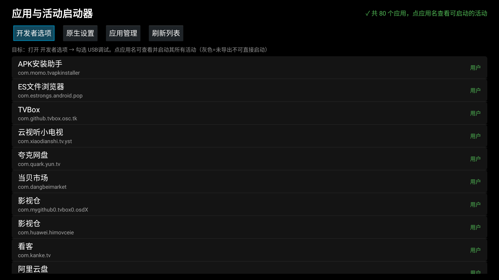
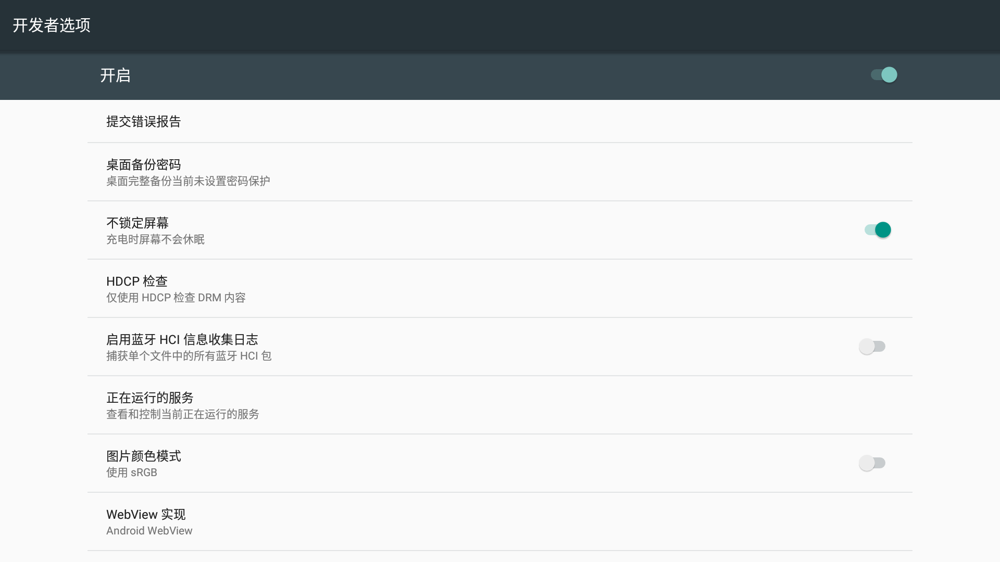
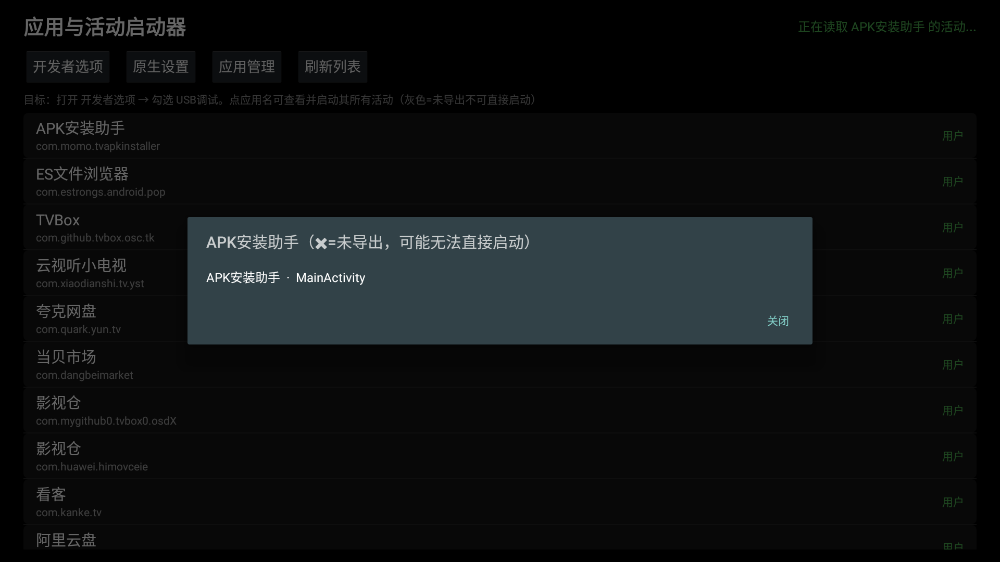

# AppLauncher / 万能启动器

**TV Activity Launcher** —— 一个为电视盒子/智能电视打造的极简"应用与活动启动器"。
列出设备上全部应用与其所有 Activity（包括被厂商隐藏的），可直接启动任意已导出活动。
内置"原生设置 / 开发者选项 / 应用管理"一键直达，用于在海信、小米等厂商定制 ROM 上
找回被藏起来的 Android 原生设置界面（典型需求：开启 ADB 调试）。

> A minimal, permission-free launcher for Android TV that lists **every installed app and
> every activity** (including vendor-hidden ones) and can launch any exported activity —
> built to recover the native Android **Settings → Developer options** on vendor ROMs
> (e.g. old Hisense TVs) where it has been hidden, so you can enable ADB debugging.

English | [简体中文](#中文说明)

---

## Screenshots / 截图

| 主界面 | 开发者选项直达 | 活动列表 |
|---|---|---|
|  |  |  |

## Features / 特性

- 📺 **零权限**：不申请任何 Android 权限，25KB 单文件 APK
- 📋 **全量应用列表**：用户应用/系统应用分组展示，显示包名
- 🔍 **活动级穿透**：点开任意应用可查看其全部 Activity（标注未导出项），一键启动
- ⚡ **快捷入口**：开发者选项 / 原生设置 / 应用管理，每种入口自动按优先级尝试
  隐式 Intent + 多个显式 ComponentName，失败时在界面上逐条显示原因
- 🕹 **遥控器友好**：D-pad 全键盘导航，兼容 Android 4.2+（minSdk 17），
  v1+v2 双签名（老设备只认 v1）
- 🧩 **无 Gradle 构建**：一条 `build.sh` 直接调用 aapt2/javac/d8/apksigner

## Motivation / 为什么做这个

厂商电视 ROM（尤其是老款海信 Android 4.4.2）通常用自家设置 UI 替换/隐藏了
原生 `com.android.settings`，导致用户无法进入开发者选项开启 ADB。
网上的教程几乎都针对新系统（连点版本号等），老系统无从下手。

Android 4.4 的原生设置中**开发者选项本来就是直接可见的**（4.2 之前无需连点彩蛋），
只是入口被藏了起来。本应用通过显式 ComponentName 与隐式 Intent 双通道把它拉起来，
并列出所有应用与活动，让你可以启动设备上任意可启动的界面。

## Usage / 使用方法（以老海信为例）

1. U 盘拷贝 APK（[Releases](../../releases) 下载），电视文件管理器安装
2. 打开 **万能启动器** → 点 **开发者选项** 按钮
3. 在原生开发者选项列表里勾选 **USB调试**（如有"网络ADB调试"也一并打开）
4. 电脑 `adb devices` 验证；仅有 USB 调试时可 `adb tcpip 5555` 转网络调试

**若直达按钮失败**（部分厂商改了设置包名）：

| 情况 | 对策 |
|---|---|
| 提示 SecurityException | 在应用列表中找名称/包名含 `settings` 的应用，浏览其 Activity 列表找 `DevelopmentSettings` 或名字含 `ADB`/`Debug`/`开发` 的项 |
| 原生设置被删除 | 找厂商自家设置（如 `com.hisense.*`），其活动列表通常有调试开关或工厂菜单入口 |
| 其它 | 把界面右上角状态区的报错文本提 [Issue](../../issues) |

## Build / 构建

要求：Android SDK（build-tools 35.0.1 + android-33/34/35 platform）、JDK 17+
（Android Studio 自带 JBR 可用）、Python 3（重生成图标时需要 Pillow）。

```bash
# 设置 SDK / JDK 环境变量（或使用脚本内置的 Windows 默认探测）
export ANDROID_SDK_ROOT=/path/to/android-sdk
export JAVA_HOME=/path/to/jdk17+

./build.sh              # 电视版：dist/AppLauncher_v1.0.apk（minSdk 17 / targetSdk 19）
./tools/build_phone.sh  # 手机版：dist/AppLauncher_v1.0_phone.apk（竖屏 / targetSdk 33 / QUERY_ALL_PACKAGES）
```

首次构建自动生成 `keystore/applauncher.jks` 本地调试签名密钥（密码 `applauncher`）。
发布自己的版本请换成你自己的密钥。图标可用 `tools/gen_icon.py` 重新生成。

> 仓库不提交任何签名密钥与构建产物；Releases 里的 APK 由维护者签名。

## Compatibility / 兼容性

- Android 4.2+（API 17），纯系统 API，无第三方依赖
- 老设备（Android 4.x）要求 APK 携带 **v1 (JAR) 签名**——本工程构建脚本已显式开启 v1+v2
- 厂商 ROM 上部分活动未导出（列表中标 ✖），这些活动无法被普通应用直接启动，属系统安全限制

## Disclaimer / 免责声明

本工具仅用于调试与维护**你自己的设备**。启动厂商隐藏界面属于常规 Android 能力
（仅限已导出的 Activity），请遵守当地法律法规，勿用于未授权用途。

## License / 许可

[MIT](LICENSE)
